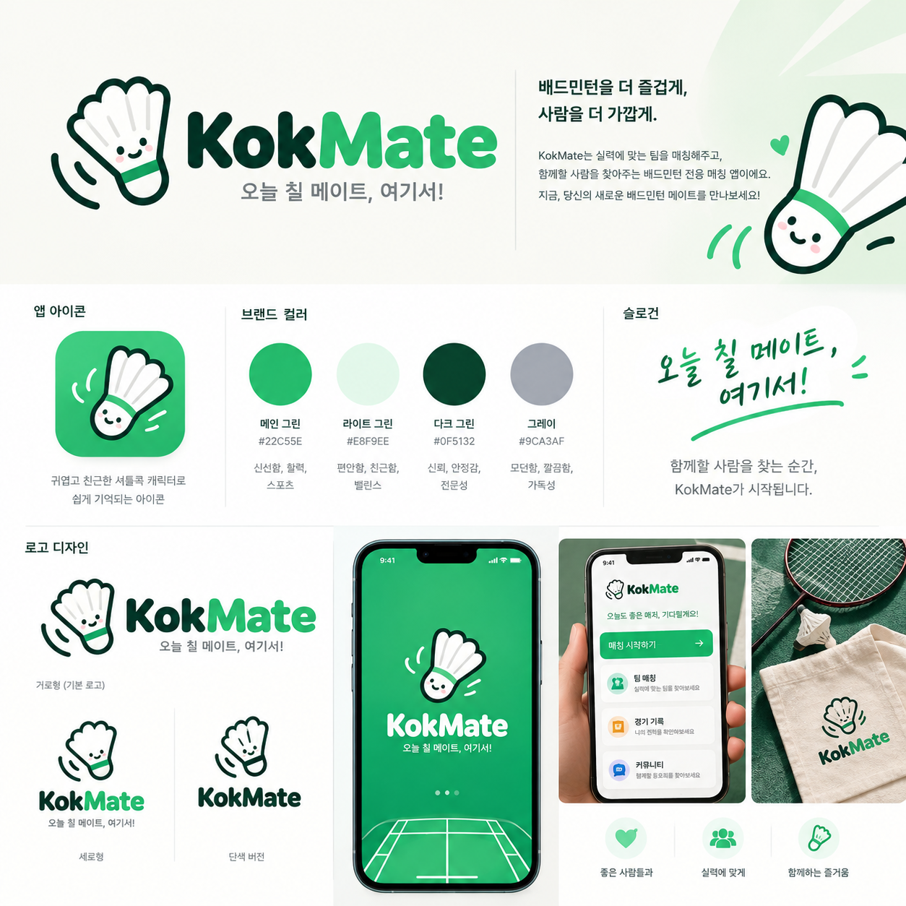
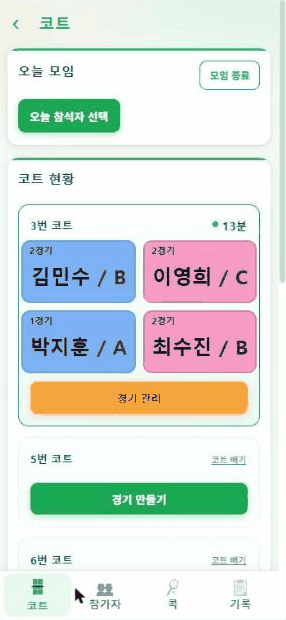
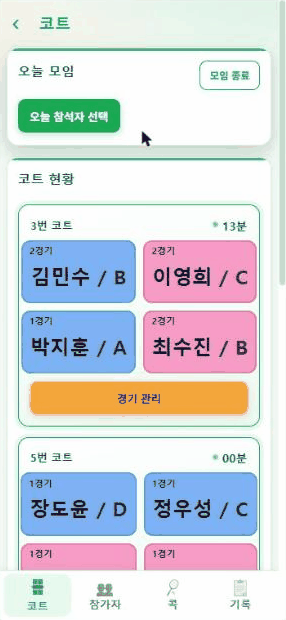
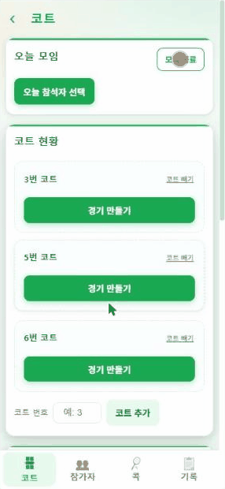

# 콕메이트 (KokMate)



배드민턴 모임에서 **누가 다음 경기에 들어갈지** 쉽게 정하고, 코트 현황·대기·콕 제출을 한 화면에서 관리하는 웹앱이다.

- 배포 주소: https://kokmate-one.vercel.app
  - 예전 주소(badminton-matcher-one.vercel.app)로 들어가도 새 주소로 넘어간다. 단, **예전 주소로 홈 화면에 추가한 앱은 새 버전을 못 받는다.** 아이콘을 지우고 새 주소에서 다시 추가한다. (그 폰에만 있던 기록은 먼저 백업 → 새 앱에서 불러오기, 팀 공유 중이면 팀 코드로 다시 참여)
- 휴대폰에서 열고 **홈 화면에 추가**하면 앱처럼 쓸 수 있다. 인터넷이 없어도 열린다.

---

## 1. 핵심 원칙

- **앱은 "누구 4명이 뛸지"만 정한다.** 팀(파트너)은 코트에서 가위바위보로 정하므로 앱에는 VS·팀 구분·승패·점수 입력이 없다.
- **사람이 직접 고르는 것이 기본**이다. 자동 추천은 오른쪽 위 ✨에 숨겨둔 보조 기능이다.
- 함께 운동하는 분들 중 노안이 있는 분이 많아 **글자는 크게, 버튼은 단순하게** 만든다. 글자 크기는 ⚙️ 설정에서 폰마다 따로 고를 수 있다.
- 남자는 **파랑**, 여자는 **분홍** 카드로 성별을 글자 대신 색으로 보여준다.

---

## 2. 모임 날 흐름

1. **참석자 고르기** — 홈에서 "경기 시작하기" → 코트 화면 → "오늘 참석자 선택" (여자/남자 탭, ㄱㄴㄷ·급수순 정렬)
2. **코트 등록** — 체육관에서 받은 코트 번호를 적고 "코트 추가" (예: 3번, 5번)
3. **경기 만들기** — 빈 코트의 "경기 만들기" → 4명 고르고 "경기 시작"
   - 모임 밖 사람(레슨자 등)을 끼워 칠 때는 우리 사람만 고르고, 남은 자리는 노란 **"외부"** 칸을 눌러 채운다(최대 3칸). 코트 카드에도 노란 "외부" 칸으로 보이고, 기록에는 "외부 인원 포함"으로 남는다. 고른 사람은 경기 수가 평소처럼 오른다. (대기 코트·선수 바꾸기도 같음)
4. **경기 끝나면** — "경기 관리" → "경기 종료" (잘못 눌렀으면 "되돌리기")
5. **모임 끝** — 맨 위 "모임 종료" → 오늘 기록이 기록 화면에 저장되고, 경기 수·콕·참석자·코트가 초기화된다. 게스트는 명단에서 빠진다.
   - 깜빡하고 안 눌렀으면 다음 날 앱을 열 때 "지난 모임 기록을 저장할까요?"라고 묻는다. (마지막 경기 후 6시간이 지나고 날짜가 바뀌었을 때. "경기 종료"를 안 누른 경기도 친 경기로 저장)

| 경기 만들기 | 경기 끝내기 | 모임 종료 |
|---|---|---|
|  |  |  |

---

## 3. 화면 구성

### 홈 화면 (앱을 열면 처음 나오는 화면)

- 앱을 열면 잠깐 초록 첫 화면(로고 · "오늘 칠 메이트, 여기서!")이 나온 뒤 홈으로 온다.
- 로고, 큰 **"경기 시작하기"**(→ 코트 화면), 메뉴 카드 **참가자 · 콕 · 기록**.
- 안쪽 화면 맨 위 `‹`나 휴대폰 '뒤로'를 누르면 홈으로 돌아온다.

### 아래 탭 줄

- 코트 · 참가자 · 콕 · 기록 화면 맨 아래에 붙어 있어서, 모임 중에 홈을 거치지 않고 한 번에 옮긴다. (지금 화면은 초록색)
- 홈 화면과 사용법에는 안 나온다.

### 코트 화면 (메인)

위에서부터 **코트 현황 → 대기 코트 → 쉬는 사람** 순서.

- **코트 현황**: 진행 중인 코트는 4명을 2×2로 보여주고, 오른쪽 위에 경과 시간(00분, 7분, 1시간 5분)을 표시한다. 버튼은 "경기 관리" 하나(안에서 종료·선수 바꾸기·취소).
- **대기 코트**: 코트가 다 찼을 때 다음 경기 4명을 미리 정해둔다(최대 6개, 한 사람은 3곳까지 — 레슨하는 운영진 등 미리 여러 판 짜두기용). 코트가 비면 대기 코트 카드에서 시작할 코트를 고른다. 잘못 골랐으면 경기 관리 → 코트 바꾸기.
- **쉬는 사람**: 지금 코트에도 대기에도 없는 사람. 경기 수가 적고 오래 쉰 사람이 앞에 온다. 아래쪽 회색 칸은 "휴식" 중인 사람이며, 누르면 바로 복귀한다. "휴식 관리" 버튼도 여기에 있다.

### 사람 카드 (대기 코트·쉬는 사람·경기 만들기 공통 양식)

```
┌─────────────────┐
│3경기       12분  │  ← 왼쪽 위: 오늘 경기 수 / 오른쪽 위: 쉰 시간
│   민수 / A       │  ← 이름 / 급수 (크고 진하게)
└─────────────────┘
```

- 쉰 시간: 막 들어오면 "00분", 20분이 넘으면 강조색.
- 다른 코트에서 뛰는 중이면 쉰 시간 대신 "경기 중".
- 게스트는 이름 옆에 작은 "게스트" 표시가 붙는다.

### 참가자 화면

- 회원 등록·수정: 이름, 성별, 급수 A~F, 역할(모임장 / 운영진 / 일반 회원 / **게스트**), 특이사항
- 같은 이름이 이미 있으면 이름 칸 밑에 "⚠ 김민수 님이 이미 있어요 (남성 / B)"라고 알려준다. (띄어쓰기 무시, 동명이인이 있을 수 있어 막지는 않음)
- **게스트**(레슨자·손님): 모임 종료하면 명단에서 자동으로 빠지고, 그날 지난 모임 기록에는 남는다. 자주 오는 사람은 일반 회원으로 넣는다.
- "여러 명 추가"로 한 번에 등록 (이미 있는 이름은 건너뜀)

### 콕 화면

- 오늘 참석자의 콕 제출 체크와 비고

### 기록 화면

- **경기 기록**: 오늘 요약, 오늘 끝난 경기(특이사항 메모), 지난 모임 기록
  - 지난 모임은 "10월 21일 (수) / 코트 3개 · 경기 18번 · 인원 11명" 한 줄 요약으로 접혀 있고, 누르면 참가자별 경기 수·메모·삭제가 나온다.
- **통계**: 오늘 참석자의 경기 수, 대기 시간(20분 넘으면 강조), 상태. 정렬은 경기 수순 / 대기 시간순(대기 → 휴식 → 경기 중)
- **누적**: 이번 달 / 올해 / 전체 기간별 출석 횟수, 경기 수, 마지막 참석일. 👑 출석왕 표시. 30일 넘게 안 왔으면 빨간색. 명단에서 지운 사람(게스트 등)은 안 나온다.
- **공유·백업**: 팀 공유, 백업 파일 만들기·불러오기

### 홈 화면 오른쪽 위 버튼

- **✨ 자동 추천** — 경기 수·급수를 보고 4명씩 조합을 짜준다. 참고용(수정·삭제·추천 지우기 가능). 거의 안 쓰지만 혹시 몰라 남겨둠.
- **⚙️ 설정** — 글자 크기(작게 / 보통 / 크게 / 아주 크게, 이 폰에서만), 팀 이름·팀 코드, 카카오톡으로 초대하기, 초대 링크 보내기, 팀 나가기
- **? 사용법** — 모임 날 4단계와 "더 알아보기"

### 화면 크기

- 컴퓨터·태블릿(폭 700px 이상)에서는 글자와 칸이 조금 더 크게 나온다. 휴대폰은 그대로.

---

## 4. 팀 공유

같은 팀에 들어간 휴대폰끼리 회원·경기·콕 기록이 자동으로 맞춰진다. (Supabase 사용, 설정 방법은 `supabase/README.md`)

- **처음 여는 휴대폰**: 팀 만들기 / 팀 코드로 참여 / 이 기기에서만 쓰기 중에서 고른다.
- **카카오톡으로 초대하기**: ⚙️ → 노란 버튼을 누르면 콕메이트 로고와 "팀 참여하기" 버튼이 있는 카톡 카드로 보낸다. 컴퓨터에서는 팝업 창으로 뜨므로, 팝업이 막힌 브라우저에서는 안 된다(그때는 "초대 링크 보내기"). 카카오 개발자 사이트에 JavaScript SDK 도메인과 제품 링크 관리 웹 도메인 두 곳 모두 kokmate-one.vercel.app이 등록돼 있어야 한다.
- **초대 링크**: ⚙️ → "초대 링크 보내기"로 카톡방에 보내면, 받은 사람은 링크를 누르고 "참여하기"만 누르면 된다. 내 컴퓨터(localhost)에서 보내도 링크는 항상 실제 주소(vercel.app)로 나간다.
- **팀 이름**: ⚙️에서 팀 이름 줄을 눌러 바로 고친다. 다른 기기에도 반영된다.
- **팀 나가기**: 이 휴대폰의 팀 데이터를 지우고 처음 화면으로 돌아간다. 팀 데이터는 서버에 그대로 남는다.
- 맞추기는 자동이다(실시간 알림 + 15초마다 확인 + 인터넷 다시 연결될 때). 인터넷이 없으면 휴대폰에 저장해 두었다가 연결되면 올린다.
- 아직 로그인이 없어서 **팀 코드를 아는 사람은 누구나 데이터를 보고 고칠 수 있다.** 팀원에게만 공유한다.
- 새 휴대폰은 빈 회원 명단으로 시작하고, 팀에 참여하면 팀 명단이 들어온다.

---

## 5. 개발 / 실행

React + Vite 프로젝트 (Node.js 필요)

```bash
npm install      # 처음 한 번
npm run dev      # 개발 서버 → http://localhost:5173
npm test         # 자동 테스트 (tests/ 폴더, 몇 초)
npm run build    # 자동 테스트 → 통과하면 배포용 빌드 → dist/
npm run preview  # 빌드 결과 미리보기
```

`main` 브랜치에 푸시하면 Vercel이 자동으로 배포한다. 배포 전에 자동 테스트가 먼저 돌고, **하나라도 실패하면 배포가 멈춘다.** 테스트는 가짜 저장소와 가짜 시계를 써서 실제 팀 데이터·서버에는 닿지 않는다. 배포 직후 이미 쓰던 휴대폰은 앱을 한 번 껐다 켜면 새 버전이 나온다(오프라인용 캐시 때문).

### 폴더 구조

- `src/App.jsx` — 화면 틀(화면 넘김, 맨 위 `‹`, 아래 탭 줄, 모달, 확인 창, 처음 화면)
- `src/views/` — 화면별 (`Menu` 홈, `Home`·`Courts` 코트, `Players`, `Shuttles`, `Records`(`History` 경기 기록·`Stats` 통계·`Cumulative` 누적·`Backup`), `Help`, `Welcome`)
- `src/modals/` — 팝업 창 (참석자 선택, 선수 고르기, 자동 추천, 경기 종료/특이사항 등)
- `src/components/` — 공용 카드(`cards.jsx`), 팀 공유 카드(`TeamCard.jsx`), 캐릭터(`Mascot.jsx`), 첫 화면(`Splash.jsx`)
- `src/actions.js` — 상태를 바꾸는 동작 (경기 시작/종료, 모임 종료 등)
- `src/store.js` — 상태 저장소 (localStorage `bm-matcher-state-v1`)
- `src/lib/` — 계산 함수(`selectors.js`), 자동 추천(`matching.js`), 팀 동기화(`sync.js`), 글자 크기(`fontSize.js`)
- `src/supabaseConfig.js` — Supabase 주소와 공개 키
- `supabase/` — 서버 설정 SQL과 설정 방법

### 데이터 구조 (요약)

```text
Player  id, name, gender(M/F), level(A~F), role(owner/staff/member/guest),
        active(오늘 참석), resting(휴식), totalGames, restSince(쉬기 시작한 시각),
        shuttleDone, shuttleNote
Game    id, court, teamA, teamB(4명 저장용, 팀 의미 없음), startTime, endTime,
        status(progress/done), memo, date
WaitingMatch  id, teamA, teamB
Session (sessionHistory) id, date, endedAt, totalGames, usedCourts, memos,
        participants[{id, name, gender, level, totalGames}]  ← 이름도 같이 저장해서 회원을 지워도 기록에 남음
State   players, games, waitingMatches, pendingRecs, settings.courts,
        sessionHistory, teamName
```

- 글자 크기는 팀 데이터가 아니라 그 폰에만 저장한다 (localStorage `bm-font-scale`).

---

## 6. 앞으로 할 수 있는 것

- 카카오 로그인 + 권한 (모임장 승인, 운영진만 경기 편집, 일반 회원은 보기만)
- 팀 로고 넣기 (할지 생각 중)
- "초대 링크 보내기"로 보낸 링크에도 로고 미리보기 카드 뜨게
- 여러 팀 오가기 (지금은 폰 하나에 팀 하나)
